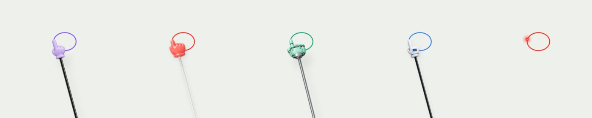

# TinyHand for Linux

[](#install)
[](./LICENSE)

A tiny hand on a stick that points at things on your Linux screen.



A Linux port of [TinyHand](https://tinyhand.app) by Kamran Ahmed, with the same 36 hands and tap sounds.

Works on Wayland desktops with layer-shell support: niri, Sway, Hyprland, KDE Plasma, COSMIC and others. GNOME works through a small helper extension that ships with the app (experimental).

## Install

### Nix

Try it without installing:

```bash
nix run github:xdinterface/tinyhand-linux -- toggle
```

Install it into your profile:

```bash
nix profile install github:xdinterface/tinyhand-linux
```

Or with Home Manager, which also starts it with your session:

```nix
# flake.nix
inputs.tinyhand.url = "github:xdinterface/tinyhand-linux";

# home.nix
imports = [inputs.tinyhand.homeModules.default];
programs.tinyhand.enable = true;
```

Options: `programs.tinyhand.settings` writes the config file for you (it then becomes read-only, so the toolbar and settings window can't save changes), and `programs.tinyhand.systemd.enable` (on by default) starts TinyHand with your session.

### From source

You need Rust 1.92 or later, GTK 4.14 or later, libadwaita 1.6 or later, gtk4-layer-shell and ALSA headers.

```bash
# Debian 13, Ubuntu 25.04 or later
sudo apt install build-essential pkg-config libgtk-4-dev libadwaita-1-dev libgtk4-layer-shell-dev libasound2-dev
# Fedora
sudo dnf install gcc pkgconf-pkg-config gtk4-devel libadwaita-devel gtk4-layer-shell-devel alsa-lib-devel
# Arch
sudo pacman -S --needed base-devel gtk4 libadwaita gtk4-layer-shell alsa-lib
```

Then build and install to `/usr/local`:

```bash
git clone https://github.com/xdinterface/tinyhand-linux
cd tinyhand-linux
cargo build --release
sudo install -Dm755 target/release/tinyhand /usr/local/bin/tinyhand
sudo mkdir -p /usr/local/share/tinyhand
sudo cp -r assets/hands assets/sounds assets/icons /usr/local/share/tinyhand/
sudo install -Dm644 -t /usr/local/share/applications data/*.desktop
sudo install -Dm644 -t /usr/local/share/icons/hicolor/scalable/apps assets/icons/io.github.xdinterface.TinyHand.svg
```

Start it once with `tinyhand`, or turn on Settings → General → Open TinyHand when you log in.

### Shortcuts

TinyHand doesn't grab global shortcuts itself. Bind these two commands in your desktop:

| Command | Suggested key |
|---|---|
| `tinyhand toggle` | Ctrl+Alt+H |
| `tinyhand clear` | Ctrl+Alt+X |

niri:

```kdl
binds {
    Ctrl+Alt+H { spawn "tinyhand" "toggle"; }
    Ctrl+Alt+X { spawn "tinyhand" "clear"; }
}
```

Sway: `bindsym Ctrl+Alt+h exec tinyhand toggle`. Hyprland: `bind = CTRL ALT, H, exec, tinyhand toggle`. KDE and GNOME: System Settings → Keyboard → Shortcuts → add a custom command.

### GNOME

Install the helper extension and turn it on, then log out and back in:

```bash
cp -r gnome-extension/tinyhand@xdinterface.github.io ~/.local/share/gnome-shell/extensions/
gnome-extensions enable tinyhand@xdinterface.github.io
```

The Nix package already includes the extension; only the `enable` step is needed.

## Use

| | |
|---|---|
| `tinyhand toggle`, or click the tray icon | Turn the pointer on or off |
| Click | Tap (nothing underneath gets clicked) |
| Hold and drag | Draw on the screen |
| `tinyhand clear`, or C | Clear the drawing |
| Hold Alt | Click for real |
| Esc | Clear everything and turn the pointer off |
| 1–9, M | Pick a pointer from the toolbar, mute |

While the pointer is on, a small toolbar at the bottom of the screen lets you pick one of 36 hands or a laser dot, change the ink colour, mute the tap sound, or exit.

More commands: `tinyhand on`, `off`, `pick <id>`, `list`, `sound [on|off]`, `status`, `settings`, `make-hand <image> [name]`, `quit`. See `tinyhand --help`.

## Settings

Open them with `tinyhand settings` or from the tray menu. Everything is also in a plain config file, `~/.config/tinyhand/config.toml`, which you can keep in your dotfiles. TinyHand reloads it when it changes, and every key is optional:

```toml
pointer = "lavender"      # see `tinyhand list`
size = 0.13               # 0.08 to 0.20 of the screen height
shadow = true
toolbar = ["lavender", "glove", "coral", "plush", "robot", "laser"]   # up to 8
ink-color = "match"       # match, red, orange, yellow, green, blue, purple, white, black
ink-fade = 3              # seconds; 0 keeps lines until cleared
ink-button = true
tap-sound = "thock"       # thock, click, pop, wood, boop, squeak
sound = true
laser-sound = false
interact-key = "alt"      # alt, ctrl, super, shift, off
keyboard = "grab"         # "pass" lets you type in apps while the pointer is on
tray = true
```

## Make your own hand

Settings → Pointers → Make your own… writes a prompt for ChatGPT or another image tool, checks the image you get back and puts it on a stick. From the terminal: `tinyhand make-hand hand.png "My hand"`.

## License

MIT. See [LICENSE](LICENSE). Hands, sounds and the logo are from the original [TinyHand](https://github.com/nilbuild/tinyhand) by Kamran Ahmed, also MIT.
